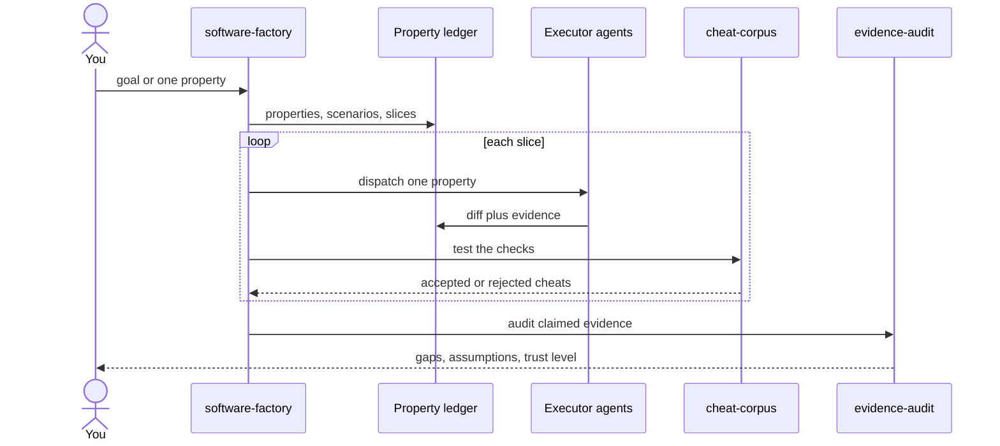
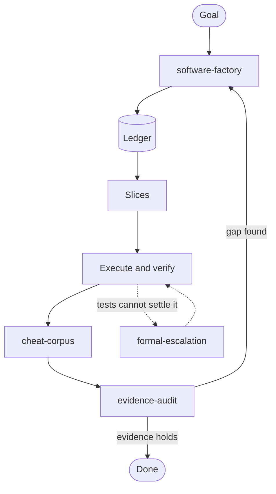

# Agents

Skills for building software from observable properties, one small verifiable diff at a time.

## The loop

## Which skill when

## Skills

| Skill | Job |
|---|---|
| `software-factory` | Turn a goal into a ledger, plan slices, run the loop |
| `cheat-corpus` | Prove the checks can actually fail |
| `evidence-audit` | Separate claimed evidence from real evidence |
| `formal-escalation` | Use models and proofs when tests are not enough |
| `code-writing-principals` | Compaction and small batches |
