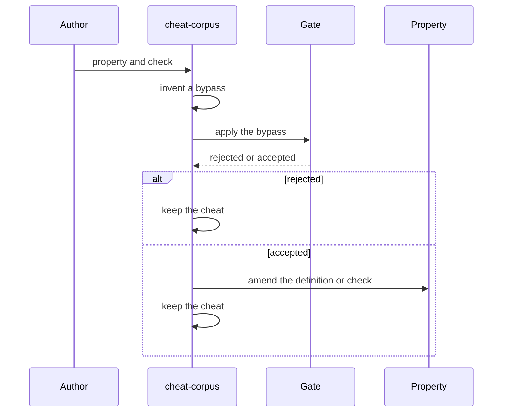
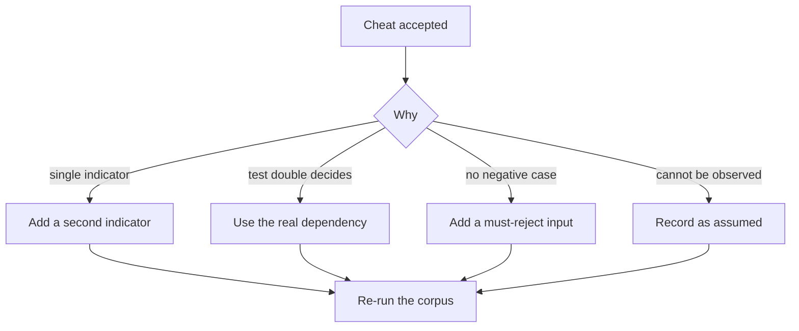

# cheat-corpus

Tests the checks, not the code.

## Rules

- Minimal, compiling, plausible.
- Never delete a cheat after fixing it.
- A cheat that passes means the check is too weak, not that the cheat is wrong.
- If no cheat can be written, the property is not testable; record that.
