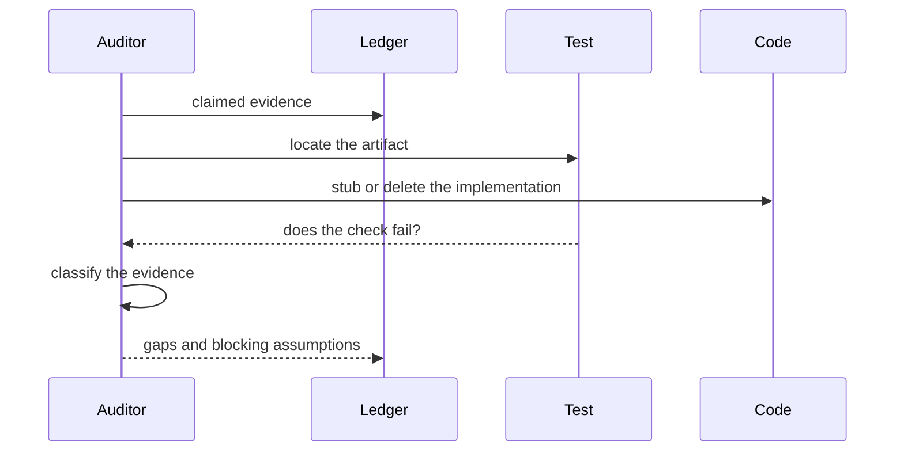
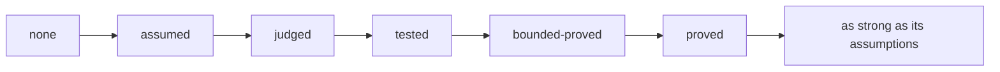

# evidence-audit

Turns "the tests pass" into a claim about what is actually established.

## Red flags

- The test passes with the implementation deleted.
- The double enforces the property.
- The assertion restates the code.
- The check never runs in CI.
- A proof does not name its model.
- A waiver has no expiry.
