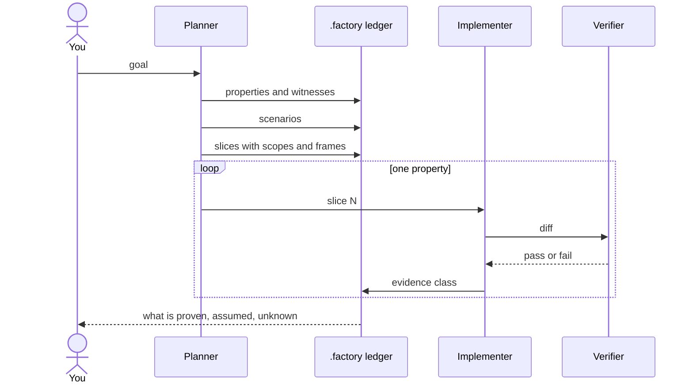
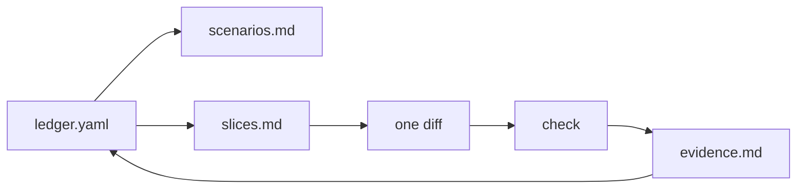

# software-factory

A goal becomes a ledger; the ledger becomes slices; each slice is one small diff and one check.

## Artifacts

## Phases

| Phase | Output | Gate |
|---|---|---|
| 1. Ledger | properties, witnesses, evidence classes | every property can fail |
| 2. Plan | slices, scopes, frames | one property per slice |
| 3. Execute | one diff, one check | full suite stays green |
| 4. Audit | evidence report | claimed equals actual |
| 5. Escalate | model or proof | assumptions named |

## Rules that matter most

- A property without a witness cannot fail.
- A diff that closes five properties and then fails tells you nothing.
- The frame is the whole suite, not the package you touched.
- An obligation whose locus is not code is refused, not faked.
